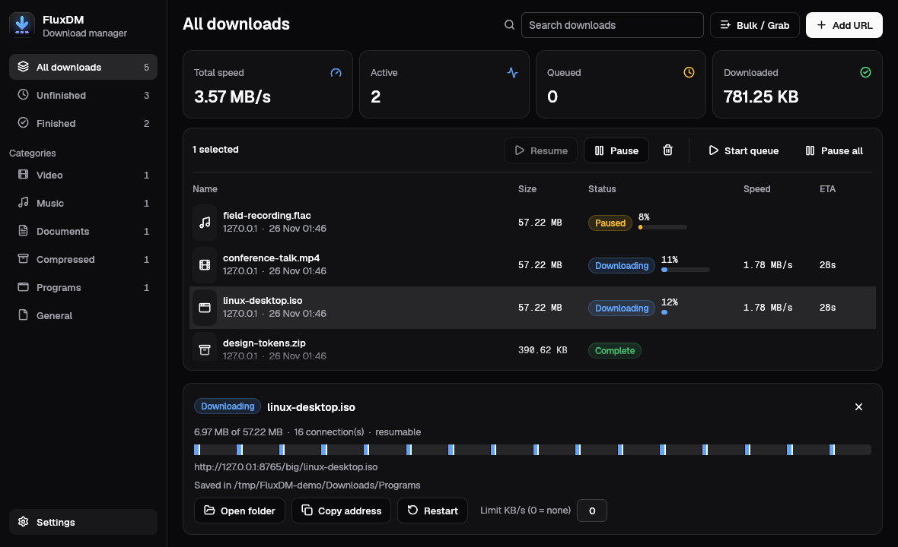
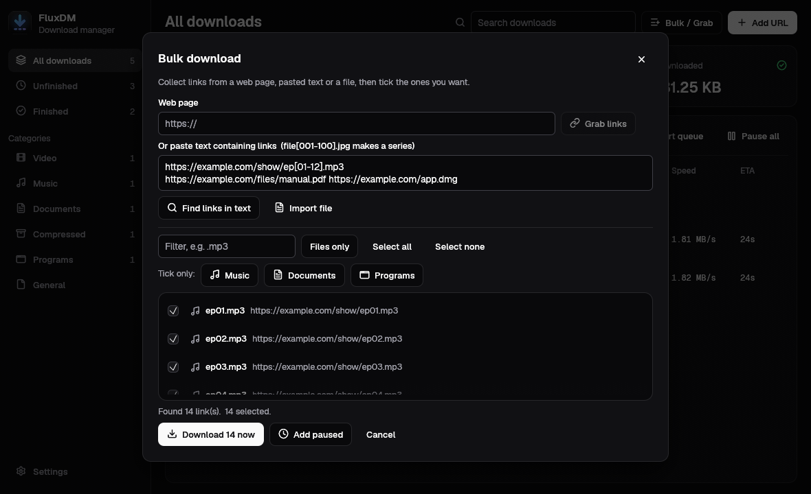
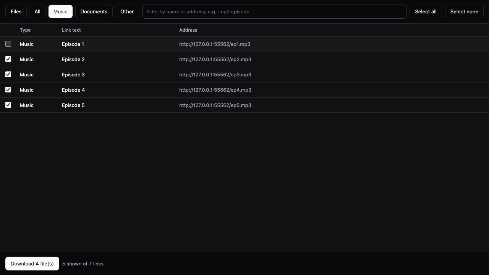
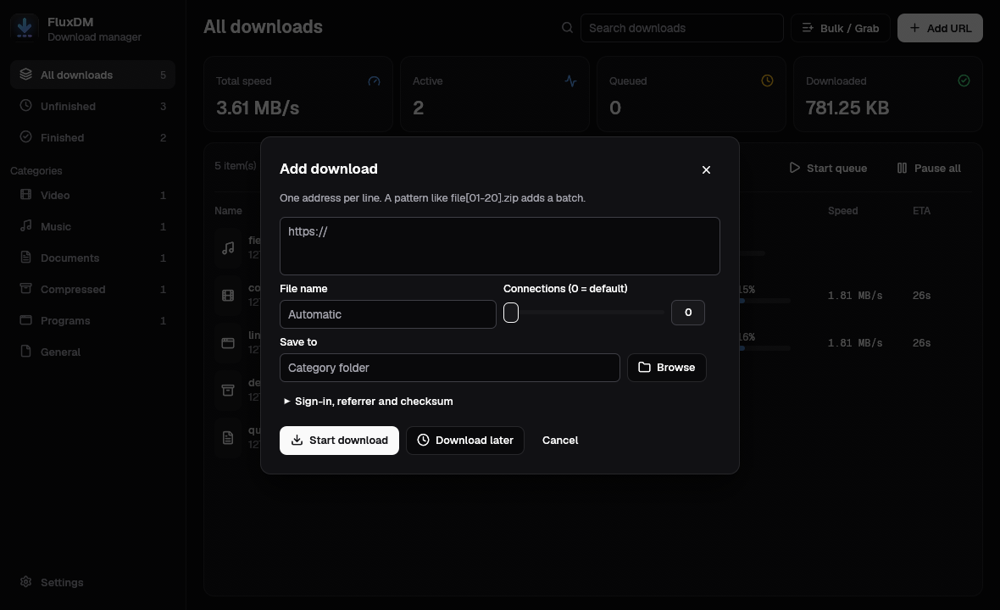
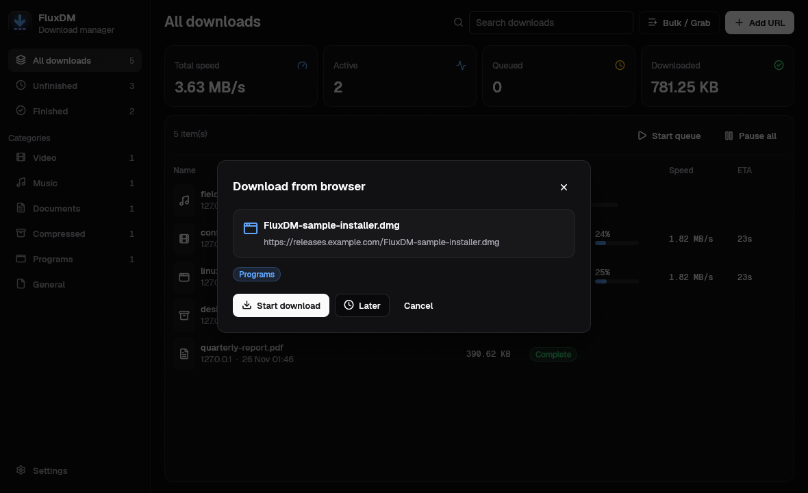
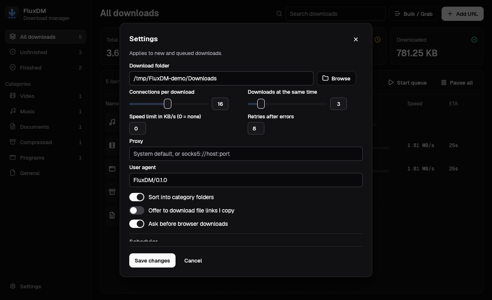
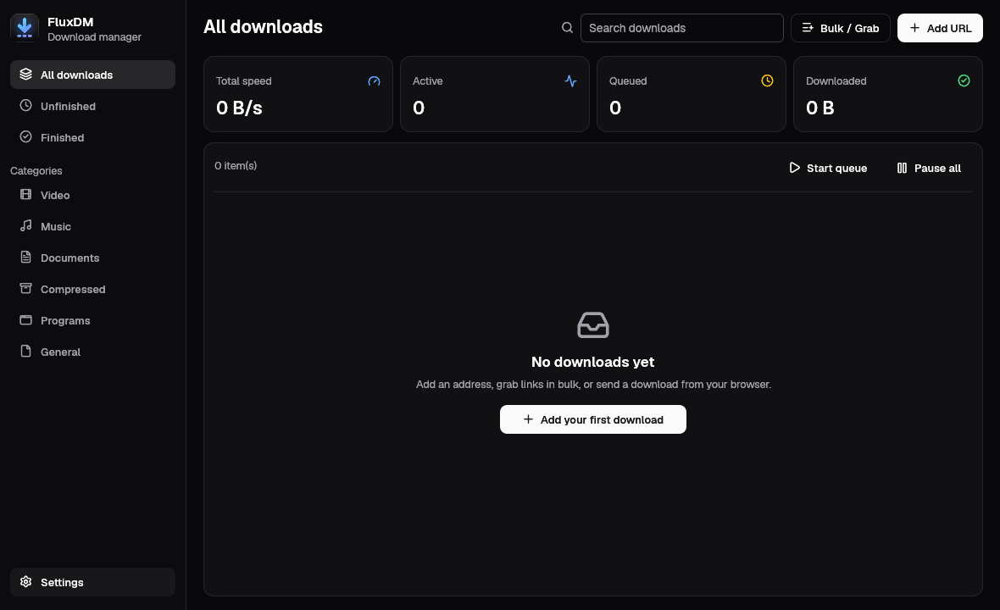
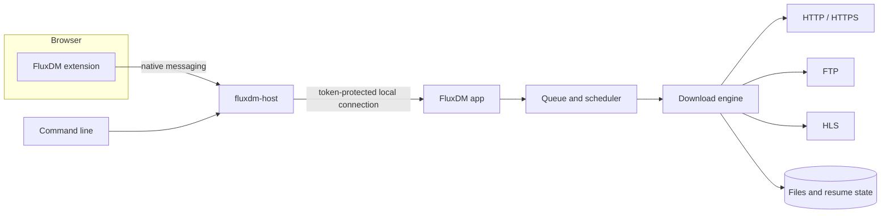

<div align="center">


# FluxDM

**A fast, free download manager with browser capture, written in Rust.**

No accounts, trials, licence keys, adverts or telemetry.

[](https://github.com/SolankiYogesh/fluxdm/actions/workflows/build.yml)


[Features](#features) · [Install](#install) · [Browser extension](#browser-extension) · [Usage](#usage) · [How it works](#how-it-works) · [Development](#development)

<br>



</div>

---

## Features

### Download engine

- **Up to 32 connections per file** (16 by default). When a connection finishes
  early, it takes over half of the largest remaining piece.
- **Resume** after pausing, a dropped network, a crash or a restart.
- **File safety:** FluxDM will not stitch together two versions of a file that
  changed on the server.
- **Retries with back-off**, using fewer connections when a server limits them.
- **Checksums:** verify with SHA-256, SHA-1 or MD5.
- **Expired links:** paste a new address and continue.
- **HTTP, HTTPS and FTP**, HTTP and SOCKS5 proxies, Basic and Digest sign-in.
- **HLS video:** picks the best quality, handles standard AES-128, and merges
  separate audio when `ffmpeg` is installed. DRM is not supported.

### Know before you download

Paste a link and FluxDM looks up the **file name, size and destination folder**,
and shows whether the download can be resumed. The same details appear when a
download arrives from your browser or clipboard. You can change the name and
folder before starting.

### Bulk and automatic capture

- Grab the links on a web page, find them in pasted text, or import a file.
- Expand numbered series such as `file[001-100].jpg`.
- Filter by name or type, then download only what you tick.
- Copy a file address and FluxDM offers to download it.
- Take over browser downloads, or pick links from the current page.

### Notifications

- A system notification when downloads **finish or fail**, however they were
  added: by hand, in bulk, from the browser or clipboard, or by the scheduler.
- Downloads finishing close together share one notification.
- In-app cards with **Open file** and **Show folder** buttons.
- Switch each kind, and the sound, on or off in Settings, and send a test.

FluxDM must be running. The command line downloader prints its result and does
not send notifications. On macOS, allow notifications when asked (or later under
**System Settings → Notifications**); this needs the app bundle, such as the one
the install script creates.

### Organisation

- Automatic categories: Video, Music, Documents, Compressed, Programs, General.
- A queue with a limit on simultaneous downloads.
- A daily or weekly schedule.
- Speed limits for everything or for a single download.
- Search, filters and a dark interface.

## Screenshots

<table>
  <tr>
    <td width="50%"><br><div align="center"><b>Bulk download</b></div></td>
    <td width="50%"><br><div align="center"><b>Browser link picker</b></div></td>
  </tr>
  <tr>
    <td><br><div align="center"><b>Add a download</b></div></td>
    <td><br><div align="center"><b>Browser capture</b></div></td>
  </tr>
  <tr>
    <td><br><div align="center"><b>Settings and scheduler</b></div></td>
    <td><br><div align="center"><b>First launch</b></div></td>
  </tr>
</table>

<sub>Screenshots use sample files served from a local test server.</sub>

## Install

### Packaged builds

The [build workflow](https://github.com/SolankiYogesh/fluxdm/actions/workflows/build.yml)
produces these packages. Download published versions from
[Releases](https://github.com/SolankiYogesh/fluxdm/releases/latest). Builds of
other commits are under a successful run's **Artifacts** (GitHub sign-in
required).

| Platform | Package | Tested so far |
|---|---|---|
| macOS, Apple silicon and Intel | universal `.dmg` | Developed and tested on Apple silicon; Intel not run |
| Windows x64 | portable `.zip` | Built and engine-tested in CI; app not yet tried by hand |
| Windows ARM64 | portable `.zip` | Built in CI; not yet run |
| Linux x64 and ARM64 | `.deb`, `.tar.gz` | Built in CI, with a `.deb` install check; engine tests run on x64; app not yet tried by hand |
| Chromium browsers | extension `.zip` | Tested in Chromium |

The macOS, Windows and Linux archive packages include setup help. The apps are not
code signed or notarised, so macOS and Windows warn on first launch. On macOS,
allow the app under **System Settings → Privacy & Security**.

### From source

You need a recent stable [Rust toolchain](https://rustup.rs).

```bash
git clone https://github.com/SolankiYogesh/fluxdm.git
cd fluxdm
```

**macOS**

```bash
./scripts/install-macos.sh
open ~/Applications/FluxDM.app
```

> [!IMPORTANT]
> Don't register the browser helper from a build inside Desktop, Documents or
> Downloads. macOS privacy protection can stop the browser from launching it. The
> script installs to `~/Applications` to avoid this.

**Linux** (Ubuntu or Debian)

```bash
sudo apt-get install -y build-essential cmake libxkbcommon-dev libxkbcommon-x11-dev \
  libwayland-dev libx11-dev libxcb1-dev libxcb-render0-dev libxcb-shape0-dev \
  libxcb-xfixes0-dev libgl1-mesa-dev
cargo build --release
target/release/fluxdm-host install
```

**Windows** (PowerShell)

```powershell
cargo build --release
.\target\release\fluxdm-host.exe install
.\target\release\fluxdm.exe
```

Keep `fluxdm.exe` and `fluxdm-host.exe` together in a permanent folder.

## Browser extension

Works with Chromium-based browsers. The helper registers itself for Chrome and
Edge, and on macOS and Linux also for Brave, Chromium and Vivaldi.

1. Register the helper (the macOS script does this for you).
2. Open `chrome://extensions` and turn on **Developer mode**.
3. Choose **Load unpacked** and select the extension folder:
   - macOS script install: `~/Applications/FluxDM.app/Contents/Resources/extension`
   - source checkout on Windows or Linux: `extension/`
   - packaged build: the `extension` folder named in its instructions
4. Turn off other download manager extensions, then refresh open pages.

| Action | What happens |
|---|---|
| Click a file link | FluxDM takes over the download |
| <kbd>Alt</kbd> + click | The browser keeps that download |
| Right-click a link | **Download with FluxDM** |
| Right-click a page or selection | Pick all or selected links |
| Play supported media | A **Download media** button can appear |

Capture is decided by file extension or the server's file type. In the popup you
can capture every download, set a minimum size or exclude sites. If the app can't
accept a download, the browser keeps it.

## Usage

- **Add URL:** paste an address to see its name, size and folder. You can also
  add several at once, and set connections, sign-in and a checksum.
- **Bulk / Grab:** collect many links and choose which to download.
- **Double-click** a download to open it when complete, or to pause or resume it.
- **Cmd/Ctrl + click** to select several downloads.

### Command line

```bash
# Download without opening the app
fluxdm-host get https://example.com/file.zip -o ~/Downloads -n 16

# Limit to 2048 KiB/s and verify the result
fluxdm-host get https://example.com/file.iso -l 2048 -c sha256:HEX

# Send addresses to the app
fluxdm-host add https://example.com/a.zip https://example.com/b.zip
```

Run `fluxdm-host` with no arguments to see all options.

## Performance

Multiple connections help when a server limits **each connection**. This test used
a 32 MiB file from a local server limited to 1 MiB/s per connection:

| Downloader | Time | Speed |
|---|---:|---:|
| curl, 1 connection | 32.65 s | 1.0 MiB/s |
| FluxDM, 1 connection | 33.28 s | 1.0 MiB/s |
| FluxDM, 8 connections | 4.34 s | 7.4 MiB/s |
| FluxDM, 16 connections | 2.32 s | 13.8 MiB/s |
| FluxDM, 32 connections | 1.30 s | 24.7 MiB/s |

> [!NOTE]
> This is a best case. Extra connections cannot exceed your internet speed or a
> server's total limit per user. With no server limit, one and many connections
> performed the same, and curl was faster than FluxDM on the local machine.

## How it works



1. FluxDM asks the server for the file and checks whether it supports ranges.
2. It splits the remaining bytes between connections and writes them into one
   partial file.
3. It saves progress regularly, so an interrupted download can continue.
4. It checks that the file hasn't changed, verifies any checksum, then moves the
   finished file into place without overwriting existing files.

If a server doesn't support ranges, FluxDM downloads over one connection.

## Development

```bash
cargo clippy --workspace --all-targets -- -D warnings
cargo test --workspace
node --test extension/tests/rules.test.mjs
```

The engine tests use a local server that drops and limits connections, ignores
ranges and changes files, and they compare downloads byte for byte.

### Project layout

```text
crates/
  core/        download engine, queue and local IPC
  app/         desktop interface (egui)
  host/        browser helper, installer and command line
extension/     Chromium extension
packaging/     platform install files
scripts/       build, packaging and icon scripts
assets/        app icon
```

### Releases

1. Set `version` in `Cargo.toml`, run `cargo build`, and commit both
   `Cargo.toml` and `Cargo.lock`.
2. Push a matching tag, for example `v0.1.0`.
3. If every build succeeds, the workflow publishes a release with all packages
   and `SHA256SUMS.txt`. Releases are created only for version tags; other pushes
   and pull requests just build and test. The workflow stops if the tag and the
   version differ.

To package locally, use `scripts/package-macos.sh` (needs both Apple Rust
targets), `scripts/package-linux.sh` or `scripts/package-windows.ps1`. To
regenerate icons from `assets/icon.svg`, see `scripts/make-icons.mjs`.

## Limitations

- No multi-level site crawler. Page grabbing reads one page without running its
  scripts.
- No DASH, RTMP, FTPS, live streams, DRM-protected media or YouTube.
- No Firefox or Safari extension.
- No capture from other desktop apps, apart from copied links.
- Form-submitted (POST) downloads stay in the browser.
- No multiple named queues, tray icon, start at login, shutdown after downloads or
  translations.
- FTP uses a single connection.
- No Android or iOS apps.

## Privacy and security

- FluxDM has no analytics or telemetry.
- To show file details, FluxDM contacts the server as soon as you paste an
  address, before you press Start. A link that works only once may be used up.
- Cookies and passwords needed by unfinished downloads are stored
  **unencrypted** in local files. On macOS and Linux only your user account can
  read them; Windows relies on your profile folder's permissions. They are removed
  from a download's record when it completes.
- The extension asks for broad permissions, including access to all sites and
  cookies, so it can capture downloads that need your session.
- Private-window downloads are not captured.

## Contributing

Bug reports and pull requests are welcome. For a capture problem, include your
platform, browser and steps to reproduce it. Remove cookies, passwords and private
links from anything you post.

## Credits

Built with [Rust](https://www.rust-lang.org), [Tokio](https://tokio.rs),
[reqwest](https://github.com/seanmonstar/reqwest) and
[egui](https://github.com/emilk/egui). The dark palette follows
[shadcn/ui](https://ui.shadcn.com). The interface uses
[Geist](https://github.com/vercel/geist-font)
([licence](crates/app/assets/LICENSE-Geist.txt)) and
[Lucide](https://lucide.dev) icons
([licence](crates/app/assets/LICENSE-Lucide.txt)).

---

<div align="center">
<sub>Download only content you have the right to download.</sub>
</div>
